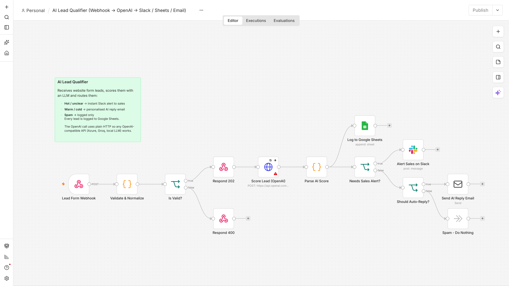
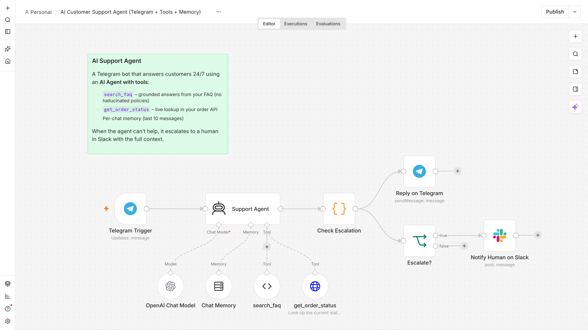
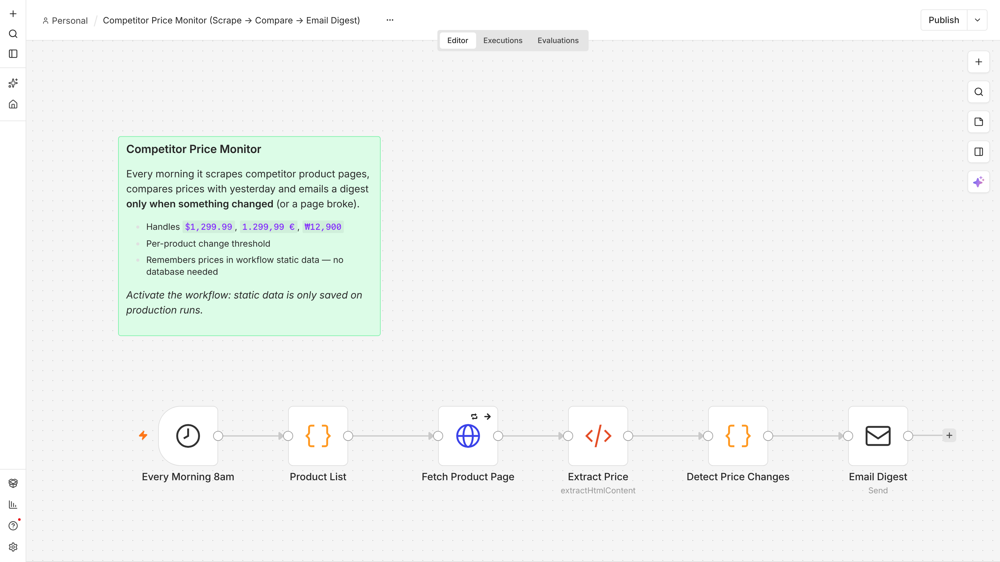

# n8n Automation Portfolio

Three production-style n8n workflows covering the automation work businesses ask for most:
**AI lead handling, AI customer support, and web monitoring**.

Every workflow is importable as-is (n8n ≥ 1.x; verified on n8n 2.47), and the custom JavaScript inside the Code nodes is unit-tested.

| # | Workflow | What it does | Stack |
|---|----------|--------------|-------|
| 1 | [AI Lead Qualifier](workflows/01-ai-lead-qualifier.json) | Scores website leads with an LLM, alerts sales about hot leads, sends personalised replies to the rest, logs everything | Webhook · OpenAI · Slack · Google Sheets · SMTP |
| 2 | [AI Support Agent](workflows/02-ai-support-agent-telegram.json) | 24/7 Telegram support bot with an AI agent, tools, per-chat memory and human escalation | Telegram · AI Agent · OpenAI · Slack |
| 3 | [Competitor Price Monitor](workflows/03-competitor-price-monitor.json) | Scrapes competitor prices daily and emails a digest only when something changed | Schedule · HTTP · HTML extract · Email |

---

## 1. AI Lead Qualifier



**Problem:** Sales teams waste hours triaging contact-form leads, and hot leads go cold while they wait.

**How it works**
1. `POST /webhook/lead-intake` receives the form (works with Webflow, WordPress, Typeform, or any HTML form).
2. Input is validated and normalised. Bad requests get an instant `400` with error details, and good ones get a `202` right away, so the website never waits on the AI.
3. An LLM scores the lead 0–100, classifies it as hot, warm, cold or spam, writes a one-line summary for sales, and drafts a reply.
4. Routing:
   - **Hot** (or if the AI response is malformed) → Slack alert to `#sales-leads`
   - **Warm / cold** → personalised reply email to the lead
   - **Spam** → no action
5. Every lead is appended to Google Sheets as a lightweight CRM.

**Reliability details:** retries on API errors, a 30 s timeout, and a fail-safe that sends any lead the AI couldn't score to a human instead of dropping it or auto-replying with nothing. The OpenAI call is plain HTTP, so any OpenAI-compatible endpoint (Azure OpenAI, Groq, OpenRouter, a local LLM) can be swapped in by changing one URL.

Try it once activated:
```bash
curl -X POST https://YOUR-N8N/webhook/lead-intake \
  -H 'content-type: application/json' \
  -d '{"name":"Jane Doe","email":"jane@acme.com","company":"Acme","message":"We need 50 seats for our sales team next month."}'
```

## 2. AI Customer Support Agent (Telegram)



**Problem:** Customers ask the same questions all day, and a plain chatbot makes up policies.

**How it works**
- An n8n **AI Agent** with two tools:
  - `search_faq` – answers come only from your FAQ, never invented.
  - `get_order_status` – a live lookup against your order API, with the response trimmed to the needed fields to save tokens.
- **Window memory keyed per chat ID**, so each customer gets a coherent conversation.
- A **human handoff**: when the agent can't help, the customer is upset, or they ask for a person, it tags the reply `[ESCALATE]`. The tag is stripped before the customer sees the reply, and the team gets a Slack message with the full context.

Swap Telegram for WhatsApp, Slack, website chat, or email, and the FAQ for Google Sheets, Notion, or a vector store (RAG), without changing the agent logic.

## 3. Competitor Price Monitor



**Problem:** Checking competitor prices by hand is tedious and easy to forget.

**How it works**
- Runs every morning. The product list (URL, CSS selector, alert threshold) is a simple editable array.
- Polite scraping: one request at a time with a 1.5 s delay, a custom User-Agent, and retries.
- Parses international price formats: `$1,299.99`, `1.299,99 €`, `₩12,900`, `1 234,50 kr`.
- Stores the last prices in n8n workflow static data, so no database is needed.
- Sends **one HTML email digest, only when a price moved past its threshold** or a page stopped returning a price (for example after a site redesign). Days with no changes send nothing.

---

## Engineering approach

```
src/                  Code-node JavaScript as plain, testable files
scripts/build-workflows.mjs   Assembles src/ into importable workflow JSON
workflows/            Ready-to-import n8n workflows (generated)
tests/                Unit tests for every Code node (node:test, zero dependencies)
docs/screenshots/     Editor screenshots
```

```bash
npm test          # 16 unit tests for the Code-node logic
npm run build     # regenerate workflows/*.json from src/
npm run check     # fail if workflows/ is out of date (for CI)
```

Keeping the logic in testable files instead of pasted into the n8n editor means changes can be reviewed and tested before they reach a client's production workflows.

## Import into your n8n

1. In n8n, open **Workflows → Import from File** and pick a file from `workflows/`.
2. Open every node with a credential and connect your own: OpenAI, Slack, Google Sheets, SMTP, Telegram, or your shop API.
3. Replace the placeholders: `YOUR_SHEET_ID`, `#sales-leads`, `hello@yourcompany.com`, `api.yourshop.com`, and the product list.
4. **Activate** the workflow.

## License

MIT
